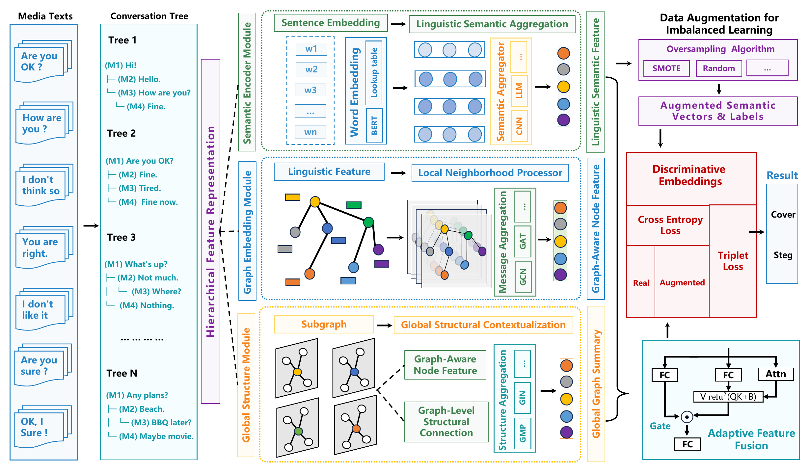

# GSDFuse

### Capturing Cognitive Inconsistencies from Multi-Dimensional Weak Signals in Social Media Steganalysis

**从多维弱信号中捕获认知不一致性的社交媒体隐写分析方法**

[](https://ieeexplore.ieee.org/document/11465080)
[](https://arxiv.org/abs/2505.17085)
[](LICENSE)

[English](README.md) | **简体中文**

本仓库提供 **GSDFuse** 的代码，结合文本内容与图结构信号，检测社交媒体对话中的隐写消息。

[方法概览](#方法概览) · [安装](#安装) · [数据准备](#数据准备) · [训练](#训练) · [对比与消融实验](#对比与消融实验) · [引用](#引用)

## 方法概览

GSDFuse 将社交媒体隐写分析建模为**节点分类任务**：消息对应节点，回复关系对应边，模型预测每条消息是否包含隐藏信息。通过结合消息语义与对话结构，模型捕获依赖上下文的微弱隐写线索。

[](assets/gsdfuse-framework.png)

*GSDFuse 整体框架，提取自 [arXiv 预印本](https://arxiv.org/pdf/2505.17085)图 2。点击图片可查看高清原图。*

| 组件 | 作用 | 启用方式 |
| --- | --- | --- |
| 文本与局部图编码 | 表征消息内容及邻域交互 | 默认启用图编码 |
| 图同构网络（GIN） | 补充采样图的结构摘要 | `--use_GIN` |
| 门控注意力单元（Gated Attention Unit，GAU） | 自适应融合文本与结构特征 | `--use_gau` |
| SMOTE | 为训练集中的少数类生成合成样本 | `--use_smote` |
| 三元组损失（Triplet loss） | 增强正常文本与隐写文本表征的可分性 | `--use_triplet_loss` |

[预印本](https://arxiv.org/abs/2505.17085)在新浪微博、Twitter 和 Reddit 数据上评估了 HC、AC、ADG 隐写场景。具体结果及实验设置请参阅论文。

## 安装

以下命令使用 Bash 语法，面向安装了 C++ 编译器的 Linux 环境；`setup.py` 显式指定了 `g++`。

```bash
git clone https://github.com/NebulaEmmaZh/GSDFuse.git
cd GSDFuse

conda create -n gsdfuse python=3.8.20 -y
conda activate gsdfuse

python -m pip install -r requirements.txt
python -m pip install flash-pytorch
python -m pip check

python setup.py build_ext --inplace
```

[requirements.txt](requirements.txt) 中声明的依赖版本如下：

| 依赖 | 版本 |
| --- | --- |
| PyTorch | 2.4.1 |
| PyTorch Geometric | 2.3.1 |
| NumPy | 1.20.3 |
| SciPy | 1.6.2 |
| scikit-learn | 1.3.2 |
| imbalanced-learn | 0.12.4 |
| PyYAML | 5.4.1 |
| Cython | 0.29.24 |

模型直接导入 `flash_pytorch.GAU`，因此即使不启用 GAU，也需要安装 `flash-pytorch`。该依赖目前未列入 `requirements.txt`，仓库也未记录原始实验使用的版本。上述说明依据现有依赖声明整理，尚未经过新的完整环境验证。使用 GPU 训练时，请选择与 CUDA 运行环境兼容的 PyTorch 构建版本。

编译命令会生成 `cython_sampler`、`cython_utils` 和 `norm_aggr` 扩展；请在运行训练代码前完成编译。

## 数据准备

训练需要**预处理后的图数据集**。当前仓库不包含数据集、预训练权重或将原始对话转换为下述格式的预处理脚本。

```text
data/<dataset>/
├── adj_full.npz
├── adj_train.npz
├── feats.npy
├── class_map.json
└── role.json
```

| 文件 | 内容要求 |
| --- | --- |
| `adj_full.npz` | 完整图的 SciPy 稀疏 CSR 邻接矩阵，形状为 `N × N` |
| `adj_train.npz` | 相同形状的 CSR 矩阵，仅保留训练节点之间的边，用于图采样 |
| `feats.npy` | 与节点编号对齐的 NumPy 数组；默认 `--sentence_embed cnn` 下，每行是一个定长整数 token ID 序列 |
| `class_map.json` | 从字符串形式的节点编号到类别标签的映射；二分类隐写检测使用 `0` 表示正常文本、`1` 表示隐写文本 |
| `role.json` | 以 `tr`、`va`、`te` 分别存储训练、验证和测试节点编号 |

节点编号须为 `0` 至 `N - 1` 的连续整数，五个文件中的编号和行顺序需要一致。划分文件示例：

```json
{"tr": [0, 1, 2], "va": [3], "te": [4, 5]}
```

以上仅展示划分格式，不构成可直接运行的示例数据集。加载逻辑及 token 重映射方式见 [utils.py 中的 `load_data` 和 `parse_n_prepare`](utils.py)。

`--data_prefix` 请使用**相对于仓库根目录的路径**，当前加载器会在路径前添加 `./`。

## 训练

在仓库根目录设置实际数据路径：

```bash
DATA_DIR="data/<dataset>"
```

### 组件组合示例

以下命令同时启用 GIN、GAU、SMOTE 和三元组损失，并使用 semi-hard 三元组挖掘：

```bash
python main.py \
  --data_prefix "$DATA_DIR" \
  --train_config train_config/gat_192_8_no_smote.yml \
  --gpu 0 \
  --repeat_time 1 \
  --use_GIN \
  --use_gau \
  --use_smote \
  --use_triplet_loss \
  --use_hard_mining \
  --mining_strategy semi-hard
```

这是组件组合的运行示例。复现论文中的具体表格时，还需对应设置数据构造方式、嵌入率、隐写比例、配置文件和重复次数。

### 配置与输出

示例 YAML 使用 192 维隐藏层、8 个注意力头、0.01 学习率、0.2 dropout，以及随机游走子图采样，最多训练 200 个 epoch。训练依据验证集 F1 保存模型，连续 20 次验证无提升后提前停止。

| 参数 | 含义 | 默认值 |
| --- | --- | --- |
| `--data_prefix` | 预处理数据目录 | 必填 |
| `--train_config` | 训练 YAML 配置文件 | 必填 |
| `--gpu` | GPU 编号 | `0` |
| `--repeat_time` | 重复运行次数 | `10` |
| `--sentence_embed` | 文本编码器 | `cnn` |
| `--dir_log` | 输出根目录 | `./test` |
| `--mining_strategy` | 启用 `--use_hard_mining` 后采用的三元组挖掘策略 | `semi-hard` |

支持的挖掘策略为 `random`、`semi-hard` 和 `hard`。完整参数（包括 SMOTE 设置）见 [globals.py](globals.py)。

默认输出如下：

- **评估指标：** `test/log_train/<dataset>/<timestamp>-graphsaint-<commit>/result.json`，记录重复运行的均值和标准差。
- **模型权重：** `test/pytorch_models/saved_model_<timestamp>.pkl`。一次调用中的多轮重复实验共用该路径，不会逐轮保留独立权重文件。

评估指标包括准确率、精确率、召回率、F1 和 micro/macro F1。`--repeat_time 1` 适合首次检查流程，正式对比请使用论文对应的实验协议。

## 对比与消融实验

### 基线模型

以下命令选择本仓库实现的基线分支：

```bash
# 仅文本（TS-CSW）。
python main.py --data_prefix "$DATA_DIR" --train_config train_config/no_graph.yml --no_graph --gpu 0 --repeat_time 1

# 文本 + 图。
python main.py --data_prefix "$DATA_DIR" --train_config train_config/gat_192_8_no_smote.yml --gpu 0 --repeat_time 1

# TGCA。
python main.py --data_prefix "$DATA_DIR" --train_config train_config/gat_192_8_no_smote.yml --gpu 0 --repeat_time 1 --use_TGCA

# CATS。
python main.py --data_prefix "$DATA_DIR" --train_config train_config/gat_192_8_no_smote.yml --gpu 0 --repeat_time 1 --use_CATS --use_GAaN
```

### 组件实验

逐项增加组件时，在上述“文本 + 图”基线命令后追加对应参数：

| 增加的组件 | 追加参数 |
| --- | --- |
| GIN | `--use_GIN` |
| GAU | `--use_gau` |
| SMOTE | `--use_smote` |
| 三元组损失与随机采样 | `--use_triplet_loss` |
| 三元组损失与 semi-hard 挖掘 | `--use_triplet_loss --use_hard_mining --mining_strategy semi-hard` |
| 三元组损失与 hard 挖掘 | `--use_triplet_loss --use_hard_mining --mining_strategy hard` |

移除组件的消融实验可从组合示例出发，删除相应开关。使用命令行控制 SMOTE 时，请以 `gat_192_8_no_smote.yml` 为基础配置；`gat_192_8_with_graph_improved.yml` 已在 YAML 中启用 SMOTE，即使不传 `--use_smote` 也会生效。

## 仓库结构

```text
GSDFuse/
├── assets/
│   └── gsdfuse-framework.png  # 从论文中提取的整体框架图
├── method/
│   ├── models.py          # 模型、特征融合与损失函数
│   ├── layers.py          # 图网络与神经网络层
│   ├── minibatch.py       # 子图批次处理
│   └── smote_sampler.py   # 少数类合成样本生成
├── train_config/          # 模型及采样配置
├── main.py                # 训练与评估入口
├── globals.py             # 命令行参数与随机种子
├── utils.py               # 数据加载与配置解析
├── metric.py              # 评估指标
├── graph_samplers.py      # 图采样接口
├── cython_sampler.pyx     # 编译式图采样器
├── cython_utils.pyx       # 编译式采样工具
├── norm_aggr.pyx          # 编译式聚合归一化
├── setup.py               # Cython 扩展编译入口
└── requirements.txt       # Python 依赖声明
```

## 引用

如果本代码或方法对你的研究有所帮助，请引用 ICASSP 2026 论文：

```bibtex
@inproceedings{huang2026gsdfuse,
  title     = {{GSDFuse}: Capturing Cognitive Inconsistencies from Multi-Dimensional Weak Signals in Social Media Steganalysis},
  author    = {Huang, Kaibo and Yang, Zhongliang and Wei, Yukun and Zhang, Zipei and Zhou, Linna},
  booktitle = {ICASSP 2026 - 2026 IEEE International Conference on Acoustics, Speech and Signal Processing (ICASSP)},
  year      = {2026},
  doi       = {10.1109/ICASSP55912.2026.11465080},
  url       = {https://ieeexplore.ieee.org/document/11465080}
}
```

## 许可证与反馈

代码采用 [MIT 许可证](LICENSE)。实现或复现相关问题欢迎通过 [GitHub Issues](https://github.com/NebulaEmmaZh/GSDFuse/issues) 反馈。
